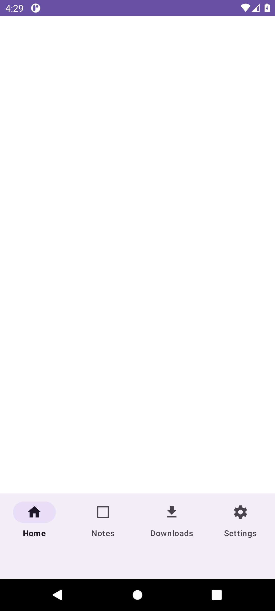

# Guptrix Android Application

[](LICENSE)
[](https://developer.android.com)
[](https://kotlinlang.org)
[](https://gradle.org)
[](https://github.com/ritikthakur22/guptrix_app/actions/workflows/ci.yml)
[](https://guptrix.netlify.app)

**Guptrix Android** (`com.guptrix.app`) is the official native Android client for the **Guptrix** encrypted note-taking and productivity ecosystem. Designed with an offline-first architecture, it bridges high-performance native Kotlin components with the modern web platform via a security-hardened WebView container, Room database cache, and background network monitor.

---

## 📱 Screenshots

| Home (Light Theme) | Home (Dark Theme) | Offline Validation |
| :---: | :---: | :---: |
|  |  |  |

| Notes & Workspace | Settings & Profile | Downloads |
| :---: | :---: | :---: |
|  |  |  |

---

## ✨ Features

- **🔐 Zero-Knowledge Security**: End-to-end client-side encryption keeps private notes, drafts, and attachments completely protected before network transmission.
- **⚡ Offline-First Architecture**: Powered by Android Room (`AppDatabase`, `NoteDao`, `NoteEntity`) and `CacheService`, allowing continuous viewing and drafting when disconnected.
- **🛡️ Hardened WebView Security**:
  - `MIXED_CONTENT_NEVER_ALLOW`: Restricts all non-HTTPS assets.
  - Sandboxed file access: Strict `allowFileAccess = false` and `allowContentAccess = false` prevent intent smuggling.
  - Safe File Provider: Integrates `androidx.core.content.FileProvider` for scoped camera and attachment sharing without exposing raw file paths.
- **📡 Resilient Network Monitoring**: `NetworkMonitor` detects active connectivity transitions via Android's `ConnectivityManager`, triggering automatic offline fallbacks and seamless page restores.
- **🎨 Material 3 Design**: Supports native edge-to-edge system bar insets, dynamic theme adaptations (light/dark), and smooth bottom navigation.
- **🚀 App Shortcuts**: Direct homescreen shortcut launcher (`shortcuts.xml`) for instant draft creation.
- **📦 Multi-Architecture Splits**: Gradle configuration generates optimized ABI APKs (`armeabi-v7a`, `arm64-v8a`) as well as universal deployment binaries.

---

## 🏗️ Architecture

```text
guptrix_app/
├── android-app/                              # Native Android Studio Project
│   ├── app/
│   │   ├── src/main/
│   │   │   ├── java/com/guptrix/app/
│   │   │   │   ├── database/                 # Room Persistence (AppDatabase, NoteDao, NoteEntity)
│   │   │   │   ├── repository/               # Note Repository abstraction layer
│   │   │   │   ├── service/                  # CacheService JavaScript Interface bridge
│   │   │   │   ├── ui/                       # UI Fragments (Home, Notes, Downloads, Settings) & Activities
│   │   │   │   ├── DownloadHandler.kt        # Android DownloadManager listener with permission safety
│   │   │   │   ├── NetworkMonitor.kt         # Reactive connectivity state monitor
│   │   │   │   ├── WebViewManager.kt         # Hardened WebChromeClient & WebViewClient controller
│   │   │   │   └── SplashActivity.kt         # Animated launch splash screen
│   │   │   ├── res/                          # Vector drawables, themes, menus, and layouts
│   │   │   └── AndroidManifest.xml           # Permissions, activities, shortcuts, and FileProvider
│   │   ├── proguard-rules.pro                # R8 minification & JavascriptInterface preservation
│   │   └── build.gradle.kts                  # App module Gradle configuration (SDK 36, ABI splits)
│   ├── gradle/wrapper/                       # Gradle Wrapper 8.5
│   ├── build.gradle.kts                      # Root Gradle configuration
│   └── settings.gradle.kts                   # Project repositories and dependencies
├── docs/                                     # Documentation, audit reports, and screenshots
│   ├── screenshots/                          # UI screenshots
│   ├── PLAYSTORE_RELEASE_REPORT.md           # Play Store build verification report
│   └── SECURITY_AUDIT.md                     # Security audit validation report
├── .github/workflows/
│   └── ci.yml                                # GitHub Actions CI workflow (Build & Lint)
├── .gitignore                                # Git ignore configuration
├── CONTRIBUTING.md                           # Contribution guidelines
├── LICENSE                                   # MIT License
└── SECURITY.md                               # Vulnerability reporting policy
```

---

## 🚀 Building & Running

### Prerequisites

- **Java Development Kit (JDK)**: Version 17
- **Android SDK**: `compileSdk = 36`, `minSdk = 23`, `targetSdk = 36`
- **Gradle**: 8.5 (handled automatically by `./gradlew`)

### Local Development

1. **Clone the repository:**
   ```bash
   git clone https://github.com/ritikthakur22/guptrix_app.git
   cd guptrix_app/android-app
   ```

2. **Build Debug APK:**
   ```bash
   ./gradlew assembleDebug
   ```
   The compiled APK will be available at:
   `app/build/outputs/apk/debug/app-debug.apk`

3. **Run Unit & Lint Checks:**
   ```bash
   ./gradlew check
   ```

### Release Build with Environment Variables

Release signing keys and credentials are never checked into version control. Configure your signing parameters using environment variables:

```bash
export KEYSTORE_PATH="/path/to/your/release.keystore"
export KEYSTORE_PASSWORD="your-keystore-password"
export KEY_ALIAS="your-key-alias"
export KEY_PASSWORD="your-key-password"

./gradlew assembleRelease
```

If no keystore is provided in the environment, Gradle builds an unsigned release binary ready for standalone signing with `apksigner`.

---

## 🔒 Security Hardening

- **No Plaintext Passwords**: Keystores and passwords are systematically excluded from git version control.
- **Isolated Storage**: Scoped storage APIs ensure that temporary files remain within private application sandboxes.
- **Protected Web Interface**: The `AndroidNoteCache` JavaScript interface strictly validates all incoming bridge requests before caching them to Room.
- **Reporting Vulnerabilities**: For details on responsible disclosure, see [SECURITY.md](SECURITY.md).

---

## 👨‍💻 Maintainer

- **Ritik Thakur** — [@ritikthakur22](https://github.com/ritikthakur22)
- **Web App**: [https://guptrix.netlify.app](https://guptrix.netlify.app)

---

## 📄 License

This project is open-source and distributed under the terms of the **[MIT License](LICENSE)**.
Copyright © 2026 Ritik Thakur & Guptrix Contributors.
